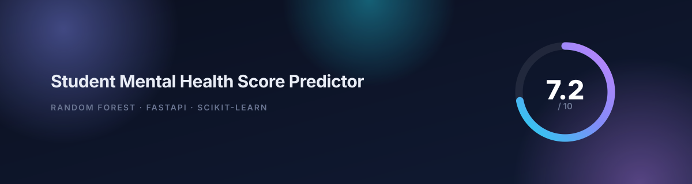
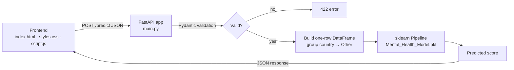

# MindScope

MindScope is a full-stack machine-learning web application that predicts a student's **mental health score** on a 0–10 scale from a handful of self-reported signals — how much time they spend on social media, how often they unlock their phone, their study, sleep and physical-activity hours, and their stress level. A trained Random Forest regression model sits behind a FastAPI API, and a responsive vanilla-JavaScript frontend submits the user's input and renders the prediction on an animated gauge with a plain-language interpretation.

The project turns a real wellbeing question — *"how are my habits affecting my mental health?"* — into a single, interpretable number someone can act on. Student mental health is a growing concern, and the relationship between excessive screen time, sleep deprivation, and chronic stress is well documented. MindScope isn't a diagnostic tool or a replacement for professional support, but it demonstrates how an ML model can surface patterns in everyday behaviour and give students an early, accessible self-check: enter your habits, get an estimated score, and see whether your current routine is pulling you up or dragging you down.

Beyond the social value, the repo is a complete, deployable example of an end-to-end ML system — data, model training, a validating API, a frontend, and cloud deployment — which makes it useful as a portfolio piece or a template for similar prediction services.

<p align="center">
  
</p>

<p align="center">
  
  
  
  
  
</p>

---

## Table of contents

- [How it works](#how-it-works)
- [The model](#the-model)
- [Features](#features)
- [API reference](#api-reference)
- [Tech stack](#tech-stack)
- [Project structure](#project-structure)
- [Getting started](#getting-started)
- [Deploying to Render](#deploying-to-render)
- [Roadmap](#roadmap)
- [Notes](#notes)
- [License](#license)

## How it works

A visitor fills out a short form on the web page — age, gender, country, academic level, their main social platform and why they use it, daily usage hours, phone unlocks, study, activity and sleep hours, and stress level. The frontend validates the input, sends it as JSON to the FastAPI `/predict` endpoint, and the API does the rest: it validates the payload with Pydantic, builds a one-row DataFrame (grouping the country into the top 10 plus "Other"), and runs it through the saved scikit-learn pipeline. The predicted score comes back as JSON, and the frontend animates a circular gauge, labels the result (Excellent / Good / Moderate / Needs Attention / At Risk), and shows insight chips recapping the key inputs.



One FastAPI service serves both the web page and the API on the same origin, so a single deployment is the whole application — no separate static host or CORS configuration needed.

## The model

Training and analysis are in [`ML_Project_Mental Health Score.ipynb`](ML_Project_Mental%20Health%20Score.ipynb). The final estimator is a `RandomForestRegressor` wrapped in a scikit-learn `Pipeline`, so all preprocessing is baked into the saved artifact — the API just calls `predict`.

```
ColumnTransformer
├── numeric columns  →  StandardScaler
└── categorical cols  →  OneHotEncoder / OrdinalEncoder
        ↓
RandomForestRegressor
```

**Inputs (13 features):**

| Feature | Type | Domain |
|---|---|---|
| Age | numeric | 10–100 |
| Gender | categorical | Male, Female |
| Country | categorical | grouped into top 10 + "Other" |
| Academic Level | categorical | Undergraduate, Graduate, High School |
| Most Used Platform | categorical | 12 platforms |
| Purpose of Use | categorical | Networking, Education, Entertainment, News |
| Avg Daily Usage Hours | numeric | 0–24 |
| Daily Unlocks | numeric | ≥ 0 |
| Study Hours | numeric | 0–24 |
| Physical Activity Hours | numeric | 0–24 |
| Sleep Hours Per Night | numeric | 0–24 |
| Stress Level | categorical | Low, Medium, High, Very High |
| Grouped Country | categorical | derived from Country |

**Target:** `Mental_Health_Score` — continuous, observed range **3.6–9.4** (mean ≈ 6.2) on an implied 0–10 scale, where higher is better.

**Performance on the training data:**

| Metric | Value |
|---|---|
| R² | **0.948** |
| MAE | 0.193 |
| RMSE | 0.293 |

These are in-sample numbers, so they're optimistic. A proper train/test split or cross-validation would give a more honest estimate, and that's the first item on the roadmap.

## Features

- **One service, everything served.** FastAPI serves the UI at `/` and the API at `/predict`, so a single Render web service is the whole app.
- **Validated by design.** Pydantic constrains every field (age 10–100, hours 0–24, fixed category lists), so malformed requests never reach the model.
- **Animated result.** The predicted score fills a circular SVG gauge with a count-up animation and a color-coded status — Excellent, Good, Moderate, Needs Attention, or At Risk.
- **Live inputs.** Usage hours, unlocks, study, activity, and sleep are sliders with real-time value labels.
- **Insight chips.** The result recaps the key inputs that drove the prediction.
- **Responsive.** Works on desktop and mobile.
- **Auto docs.** Swagger UI at `/docs`, ReDoc at `/redoc`.

## API reference

### `POST /predict`

Returns the predicted mental-health score for one student.

**Request body:**

```json
{
  "age": 20,
  "gender": "Male",
  "country": "India",
  "academic_level": "Undergraduate",
  "most_used_platform": "Instagram",
  "purpose_of_use": "Entertainment",
  "avg_daily_usage_hours": 4.5,
  "daily_unlocks": 80,
  "study_hours": 3.0,
  "physical_activity_hours": 1.0,
  "sleep_hours_per_night": 6.5,
  "stress_level": "High"
}
```

**Response body:**

```json
{ "predicted_mental_health_score": 6.03 }
```

**cURL:**

```bash
curl -X POST http://127.0.0.1:8000/predict \
  -H "Content-Type: application/json" \
  -d '{"age":20,"gender":"Male","country":"India","academic_level":"Undergraduate","most_used_platform":"Instagram","purpose_of_use":"Entertainment","avg_daily_usage_hours":4.5,"daily_unlocks":80,"study_hours":3,"physical_activity_hours":1,"sleep_hours_per_night":6.5,"stress_level":"High"}'
```

| Route | Method | What it does |
|---|---|---|
| `/` | GET | Serves the frontend |
| `/styles.css` | GET | Frontend styles |
| `/script.js` | GET | Frontend logic |
| `/predict` | POST | Returns the predicted score |
| `/docs` | GET | Interactive Swagger UI |
| `/redoc` | GET | ReDoc docs |

## Tech stack

| Layer | Choice |
|---|---|
| Model | scikit-learn `RandomForestRegressor` in a `Pipeline` + `ColumnTransformer` |
| Backend | FastAPI · Uvicorn (ASGI) |
| Validation | Pydantic v2 |
| Frontend | Vanilla HTML5, CSS3, JavaScript (fetch) |
| Persistence | `joblib`-serialized pipeline (`.pkl`) |
| Deploy | Render (Python web service + Blueprint) |

## Project structure

```
.
├── main.py                                        FastAPI app — API + serves the frontend
├── Mental_Health_Model.pkl                        trained sklearn pipeline (Random Forest)
├── Student Social Media And Mental Health Impact.csv   dataset (5,000 rows)
├── ML_Project_Mental Health Score.ipynb          training & analysis notebook
├── index.html · styles.css · script.js            the frontend
├── banner.svg                                     README banner
├── requirements.txt                                pinned Python deps
├── render.yaml                                     Render Blueprint
└── README.md
```

## Getting started

```bash
pip install -r requirements.txt
uvicorn main:app --reload
```

Then open **http://127.0.0.1:8000**. FastAPI serves the frontend at `/`, so there's nothing else to start. The interactive API docs live at `/docs` if you'd rather call the endpoint directly.

On Windows where only the `py` launcher is on PATH, use `py -m uvicorn main:app --reload`.

You can also just double-click `index.html` — the frontend detects when it's opened as a file and falls back to `127.0.0.1:8000` for the API, so the server still needs to be running.

## Deploying to Render

The repo includes a `render.yaml` Blueprint, so after pushing to GitHub: Render → **New → Blueprint** → select the repo, and it provisions the service. The build installs `requirements.txt`; the start command is:

```
uvicorn main:app --host 0.0.0.0 --port $PORT
```

That single service serves the frontend and the API on the same origin, which is why the frontend calls `/predict` as a relative URL — no CORS or separate static hosting to configure. The `.pkl` lives in the repo, so Render loads it with no extra setup.

Prefer manual setup? **New → Web Service**, connect the repo, Runtime = Python 3, and use the build/start commands above.

## Roadmap

- [ ] Honest evaluation — cross-validation / held-out test set, with a results table in the notebook
- [ ] Feature importance plot on the result page
- [ ] Prediction history (localStorage) so a user can compare scenarios
- [ ] Re-export the model under the current scikit-learn version to clear the load warning
- [ ] Light/dark theme toggle

## Notes

- The model was pickled with scikit-learn 1.7.x and is loaded with 1.9.x, so startup prints `InconsistentVersionWarning`. It predicts fine; re-exporting from the notebook with the current version would silence it.
- The dataset is synthetic and meant for learning — predictions here are not a substitute for professional mental-health support.

## License

MIT. The dataset and notebook are educational only.
